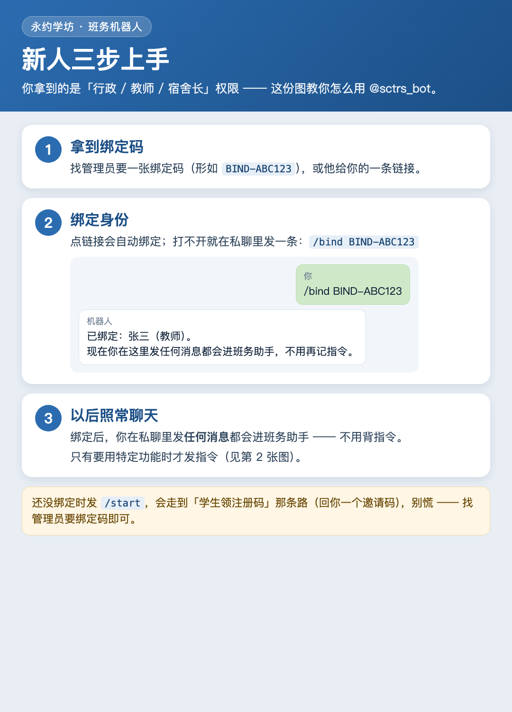
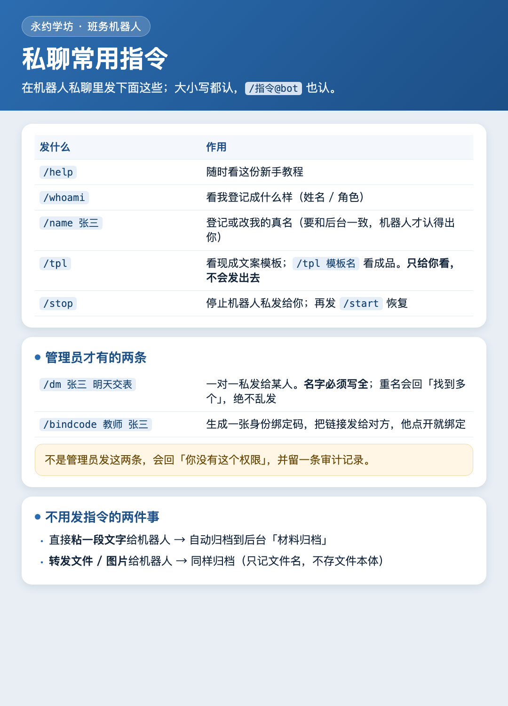
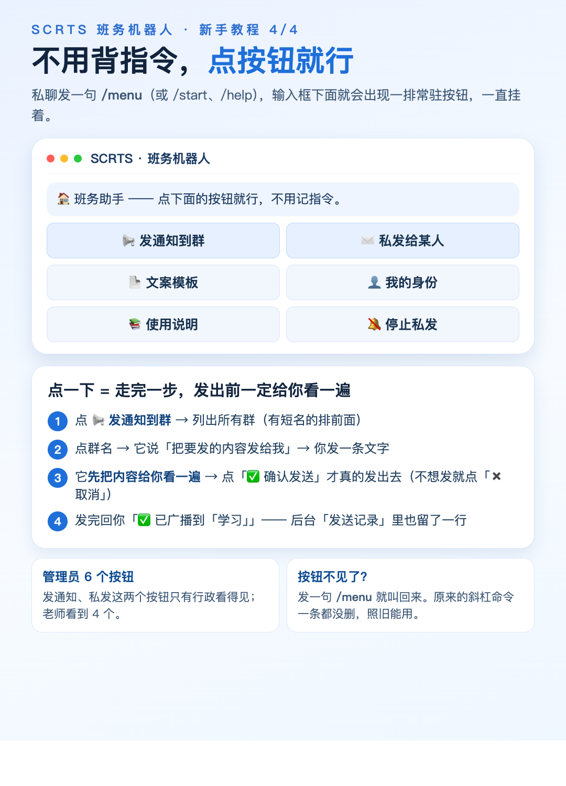
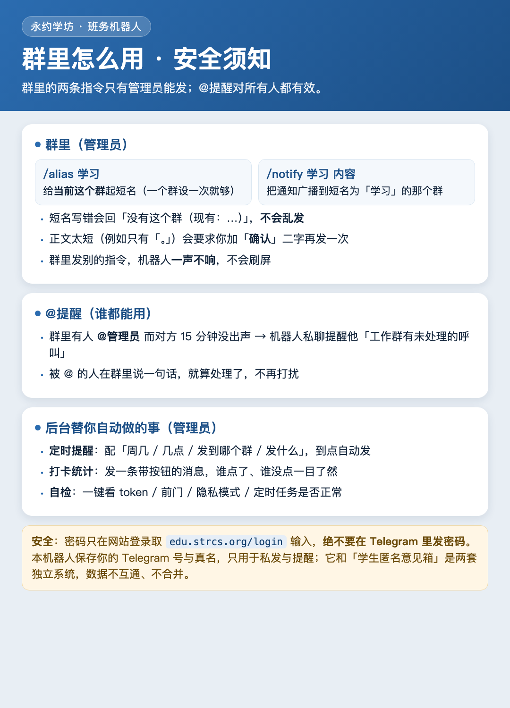

# 班务机器人使用教程（行政 / 教师 / 宿舍长）

> **最后核对**：`2026-10-13` ｜ **谁该看**：拿到「行政 / 教师 / 宿舍长」权限的人 ｜ **机器人**：`@sctrs_bot`（永约学坊 · 班务机器人）｜ **配套图**：本文四张图已随模块发布，也可在 Telegram 里直接查看

这页写给**用机器人办事的人**（不是运维）：怎么绑定身份、私聊能发什么、群里怎么广播、
以及安全上不能做什么。技术细节与硬边界见 `docs/plans/tg-assist-bot-design.md`。

---

## 一分钟版

1. **找管理员要一张绑定码**（形如 `BIND-ABC123`）或一条链接；
2. **点链接**，或在机器人私聊里发 `/bind BIND-ABC123`；
3. **以后照常聊天** —— 绑定后你在私聊里发任何消息都会进班务助手，不用背指令。



---

## 你收到的那条「新登记」私聊是什么意思

管理员会收到机器人私聊：

> 新登记：某某（Telegram：某某）。请到后台「班务机器人 → 人员映射」把他标成 行政/教师/宿舍长；
> 标好之后他发任何消息都会进班务助手。

这是**管理员侧**的提醒，不是故障：

- 有人第一次私聊机器人就会被登记进「人员映射」，那一刻他的角色默认是「其他」；
- 如果他这次是**带绑定码**来的（`/bind` / 点链接），同一次请求里角色会立刻被改成码上写的角色
  （行政 / 教师 / 宿舍长）—— 2026-10-13 修过一个「通知比事实早一瞬」的瑕疵：现在只有
  「处理完仍然是『其他』」的新人，才会真的给管理员发这条提醒；
- 所以现在的规则很简单：**收到这条 = 这个人确实需要去后台标一下角色**。

---

## 私聊里能发什么



| 发什么 | 作用 | 谁能用 |
|---|---|---|
| `/help` | 随时看新手教程（和这条入口同一份文案） | 所有人 |
| `/whoami` | 看我登记成什么样（姓名 / 角色 / Telegram 昵称） | 所有人 |
| `/name 张三` | 登记或改自己的真名（一对一私发靠真名找人，所以必须填） | 所有人 |
| `/menu` | **把点按钮的菜单叫回来**（下面「不想记指令」那一节） | 所有人 |
| `/tpl` | 列出启用的文案模板；`/tpl 模板名` 渲染一条给自己看（**只读，不会发出去**） | 所有人 |
| `/bind BIND-ABC123` | 用绑定码把自己绑成「姓名 + 角色」 | 所有人 |
| `/dm 张三 明天记得交表` | 一对一私发给某人；**名字必须写全**，重名会回「找到多个：张三/张三丰，请写全名」，绝不乱发 | 仅管理员 |
| `/bindcode 教师 张三` | 生成一张身份绑定码，把链接发给对方，他点开就绑定 | 仅管理员 |
| `/stop` | 停止机器人私发给你（`/dm` 与提醒都不会再打扰）；再发 `/start` 恢复 | 所有人 |
| 直接粘一段文字 / 转发文件图片 | 自动归档到后台「材料归档」（只记文件名与正文，不下载文件本体） | 行政 / 教师 / 宿舍长 |

不是管理员发 `/dm` 或 `/bindcode`，会回「**你没有这个权限。**」，并在后台「私发记录」留一条越权审计行。

> 为什么 `/dm` 必须写全名：宁可回一句「找到多个」，也不能猜着发给某一个人 —— 取错人等于把行政公文发错对象。

---

## 不想记指令？点按钮就行



记不住上面那些指令完全可以 —— 私聊机器人发一句 **`/menu`**（或者 `/start`、`/help`），
**输入框下面就会常驻一排按钮**，一直挂在那里：

```
📢 发通知到群     ✉️ 私发给某人      ← 只有行政 / 管理员看得见这两个
📄 文案模板       👤 我的身份
📚 使用说明       🔕 停止私发
```

点下去是**一步步来**，每一步都有回话，不会「点了没反应」：

| 点哪个 | 会发生什么 |
|---|---|
| 📢 发通知到群 | 列出所有群（有短名的排前面）→ 点一个群 → 你发一条文字 → **它先把内容给你看一遍**，点「✅ 确认发送」才真的发出去（不想发就点「✖️ 取消」） |
| ✉️ 私发给某人 | 列出教职工 → 点一个人 → 发内容 → 预览 → 确认（成功失败都留一行私发记录） |
| 📄 文案模板 | 列出现成模板 → 点一条，渲染好的文案**发给你自己**看（这一步不会发到群里） |
| 👤 我的身份 | 相当于 `/whoami` |
| 📚 使用说明 | 相当于 `/help` |
| 🔕 停止私发 | 相当于 `/stop`；重新发 `/start` 恢复 |
| 🖥 打开面板 | 在 Telegram 里打开网页版面板：填表单发群通知 / 私发、翻材料并直接转发（材料页只有教师 / 宿舍长 / 行政能看） |

- **发出前一定有预览**：点「✅ 确认发送」才出网 —— 不会手一抖就把话发出去；
- **发一半去干别的**（又发了一条命令），没确认的草稿会被自动丢掉，不会被当成正文发出去；
- 非管理员点管理按钮，会回「你没有这个权限。」并在后台留一条越权审计；
- 按钮收起来了？再发一句 `/menu` 叫回来。**原来的斜杠命令一条都没删**，两种用法随便挑。
- **🖥 打开面板**（按钮排最后一行）：点一下**不离开 Telegram** 就打开一个网页版面板，填表单发群通知、私发、翻材料并转发。
  面板认的**是你本人的 Telegram 身份**（即点即验），网址转发给别人也没有用；材料归档那一页只有教师 / 宿舍长 / 行政能看。
- **⏰ 定时群发**（在「🖥 打开面板」的主菜单里，**只有行政/教务**）：点进去 →「＋ 新建定时群发」→ 选群 → 写正文 →
  选星期几和几点 → 点「✅ 建好，以后每周自动发」。之后点这条可以「🚀 立即发一次 / ⏸ 停用 / 🗑 删除」。星期几与时间都是**北京时间**。

---

## 群里怎么用



**只有管理员能发**的两条群指令：

| 发什么 | 作用 |
|---|---|
| `/alias 学习` | 给**当前这个群**起一个短名（已有短名：`学习`「*我爱学习*」、`清洁`「清洁能源站」、`品茶`「品茶分享」、`AB`「AB合作」、`班长`「SCRTS班长群」） |
| `/notify 学习 各位同事请注意…` | 把通知**广播**到短名为「学习」的那个群 |

- 短名写错会回「没有这个群（现有：…）」，**不会乱发**；
- 正文太短（例如只有「。」「！！！」）会要求你在正文前加「**确认**」二字再发一次；
- 群里发别的指令，机器人**一声不响**，不会刷屏；
- 每次广播都会在后台「发送记录」留一行（成功/失败与错误原文）。

**@提醒（所有人都有效）**：群里有人 **@管理员**（目前配的是王佐）而对方 15 分钟没出声，
机器人会私聊提醒他「工作群有未处理的呼叫」；被 @ 的人在群里说一句话就算处理了，不再打扰。

---

## 后台（管理员）

菜单：**班务机器人**（后台 设置 里搜索「班务」即可）

| 菜单 | 用途 |
|---|---|
| 群与短名 | 看机器人都在哪些群、短名是什么 |
| 人员映射 | 把新人标成 行政 / 教师 / 宿舍长（不标 = 他发的自由文本仍走学生领码流） |
| 绑定码 | 手工生成/查看身份绑定码 |
| 私发记录 | `/dm` 与越权尝试的审计流水 |
| @提醒待办 | 谁 @了管理员、超时提醒发没发出去 |
| 按钮回填 | 内联按钮的回填记录 |
| 文案模板 | 节日/会议/学习通知等模板（`/tpl` 就是读这里） |
| 定时提醒 | 配「周几 / 几点 / 发到哪个群 / 发什么」，到点自动发 |
| 打卡统计 | 发一条带按钮的群消息，谁点了、谁没点一目了然 |
| 材料归档 | 老师私聊转发过来的材料（抽取 + 可选导出 Notion，默认零出网） |
| 发送记录 | 每一次出网的成功/失败与错误原文（排障第一站） |
| 自检 | 一键看 token / 前门 / webhook / 隐私模式 / 定时任务是否正常 |

---

## 给群起短名 / 把文件交给教务（管理员）

- **给当前群起短名**：在那个群里发一句 `/alias 学习群` —— 只有被标成「行政」的人能用；已经有短名的群改不动，会提示你换个名字。
  短名就是广播时的收件人：`/notify 学习 各位同事请注意…`。
- **把材料转给教务**：私聊把要归档的东西**转发**给机器人（文字或文件都行）→ 自动进后台「材料归档」；
  文件本体也在里面，后台点「⬇️ 取回文件」就能下载，或者直接转给教务老师。

---

## 安全与隐私（必须知道）

- **密码只在网站登录页输入**（`https://edu.example.org/login`），**绝不要在 Telegram 里发密码** ——
  机器人永远不需要你的密码，凡是索要密码的都是假的。
- 本机器人保存你的 **Telegram 号与真名**，只用于**一对一私发与提醒**；这是管理工具的明示口径。
- 它和学生**匿名意见箱**是两套独立系统：不同的机器人、不同的表、不同的路由，**数据不互通、不合并**。
- 学生发 `/start` 走的仍是「领注册邀请码」那条路，一字未变；老师请用 `/assist` 或 `/bind`。

---

## 常见问题

| 现象 | 原因 / 怎么办 |
|---|---|
| 发 `/start` 回了我一个邀请码 | 你的身份还没绑定，被前门判成了学生流。找管理员要绑定码，发 `/bind BIND-XXXXXX`。 |
| 绑定后发消息还是回邀请码 | 绑定没成功（码过期/已用过）。发 `/whoami` 看角色；再找管理员要一张新码。 |
| 发 `/dm` 回「你没有这个权限」 | `/dm` 只给管理员。让管理员在「人员映射」把你的角色改成 行政。 |
| 发 `/dm` 回「找到多个」 | 写全名（如「张三丰」），机器人不猜。 |
| 发 `/notify` 回「没有这个群」 | 短名写错了，回话里会列出现有短名；或先在本群发 `/alias 短名` 给它起名。 |
| 群里 @我不提醒 | @提醒只认**管理员**（`edu_tg_assist.owner_user_id`）；另外机器人必须关掉隐私模式才能读到群消息（生产已关）。 |
| 底下的按钮不见了 | 发一句 `/menu` 叫回来（或 `/start`、`/help`）。 |
| 点了按钮没反应 | 先发 `/menu` 重来一次；仍不行请管理员打开后台「班务机器人 → 自检」看 token / 前门 / webhook（按钮的每一次回话都会写「发送记录」）。 |
| 机器人没反应 | 先发 `/help`；仍无反应请管理员打开后台「班务机器人 → 自检」看 token / 前门 / webhook。 |

---

## 相关文档

- 运维与总览：`docs/ops/tg-assist-bot-howto.md`
- 设计与硬边界（B1–B14）：`docs/plans/tg-assist-bot-design.md`
- 交接提示词：`docs/ops/tg-assist-bot-handoff-prompt.md`
